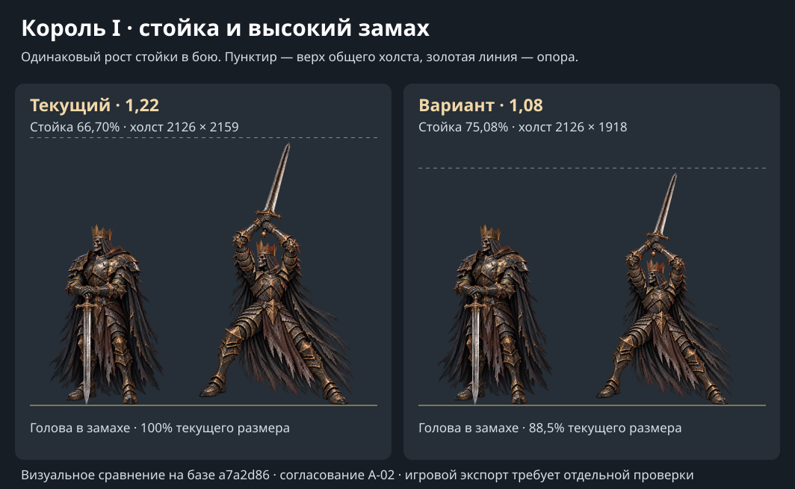

# A-02 · материалы для художественной и технической рецензии

Задача [T3 №20](https://github.com/zhopkot-bit/guild-of-shadows/issues/20). Команда T3, ответственный Codex. База `a7a2d86dafa913ac755b48143339615bf5c96cad` из зависимого [PR №16](https://github.com/zhopkot-bit/guild-of-shadows/pull/16). Принятие решений по этим материалам относится только к A-02.

| Материал | Наблюдение | Решение для рецензента |
|---|---|---|
| Нора, `shoot` | Подошва касается нижней строки в x=966…991 (26 px при α>24). | На крупном плане определить границу восстановления подошвы. При итоговой сборке проверить сохранность исходной кожи и ремней вне маски. |
| Гоблин, `hit` | В столбце x=1085 четыре интервала y=602…615, 693…705, 741…758 и 770…827 (103 px при α>24). | Сверить концы ткани с четырьмя интервалами на крупном плане. При переносе сохранить руку, броню и все пиксели вне локальной правки. |
| Король I, `strike` и `down`; король II, `hit` | Справа у `strike` два px (α≤40). У `down` слева два (α≤29), справа пять, из них два с α=165…166. У `hit` справа два (α=28). | Рассмотреть исключения по каждому краю отдельно. Справа у `down` есть заметный кончик ткани. Нужна оценка крупного плана перед выбором дорисовки или сохранения контура. |
| Король I, `prepare` | При текущем коэффициенте 1,22 стойка занимает 66,7% холста. При 1,08 получается 75,08%, но голова в `prepare` становится на 11,5% меньше. | Рассмотреть сохранение текущего размера по явному исключению. На 667×375 верхняя плашка закрывает часть поднятого меча. T2 проверяет читаемость телеграфа с интерфейсом. |
| Волк, `down` | Исходный вынос 0,771 высоты стойки при пределе 0,60. Перекрытие зависит от места в строю, движения, исчезновения и глубины отрисовки. | Для варианта со сложенными лапами и подвёрнутым хвостом сравнить размер головы и лап, вынос и видимость соседей в тех же трёх слотах. |

Отдельное художественное решение требуется для каждого исправления или исключения. T2 проверяет читаемость в бою, T5 воспроизводит результаты на согласованной базе, T6 принимает решение об интеграции. Номер проверенного коммита указан в PR.

## Воспроизведение измерений

Из корня checkout этой ветки запустите `python3 -m http.server 8000 --bind 127.0.0.1`, затем откройте следующие пути на `http://127.0.0.1:8000`.

- [Крупные планы шести касаний](review/edges.html) — `/art-sources/poses/a02-review/review/edges.html`. Измерение выполняется по альфа-каналу исходной PNG. Раскройте список, чтобы перейти между сторонами холста, и смените подложку для оценки полупрозрачных краёв.
- [Сравнение стойки и замаха короля](review/king.html) — `/art-sources/poses/a02-review/review/king.html`. Сравните коэффициенты 1,22, 1,10, 1,08 и 1,00 при одинаковом росте стоящего короля. Для интеграции каждого варианта требуется повторная проверка с HUD.
- [Перекрытия исходного волка на 667×375](review/wolf-baseline-mobile.json). При обычном исчезновении максимум по двум противникам составил 28,4%, 6,5% и 58,8% площади соседа для первого, второго и третьего слота соответственно. Передний слой определяет, какая фигура визуально закрывает другую. Соседние атаки при принудительно видимой туше выделены отдельно.

21.11.2026 сверены шесть чисел касаний и вынос 0,771 с отчётами [нормализации](../../../docs/art-review/technical-integration-2026-10-30/normalization.json) и [силуэтов](../../../docs/art-review/technical-integration-2026-10-30/silhouette-checks.json) базового коммита. Для таблицы короля повторно рассчитаны габариты всех поз с опорой и полями нормализатора. Перекрытия волка относятся к браузерному прогону 09.11.2026.

## Лист для рецензии

Обе иллюстрации на листе взяты из игровых WebP проверенной базы. При сравнении меняется масштаб замаха вокруг общей опоры. Рецензент может оценить потерю размера головы при переходе к 1,08 и решить, допустима ли стойка 66,7% при исходном коэффициенте.

**Статус 21.11.2026.** Готовы к рецензии измерения, крупные планы исходных контуров и выбор композиции короля. Проверка нового арта остаётся открытой. Эскизы сапога, плаща и волка показаны в рабочем чате. Для их художественной приёмки в репозитории предстоит приложить PNG и сравнение с исходниками, собрать предложенную позу волка и повторить замер пересечений. Облачное окружение завершило запуск ошибкой подключения исполнителя. Успешный экспорт и браузерная проверка кандидатов не подтверждены.
