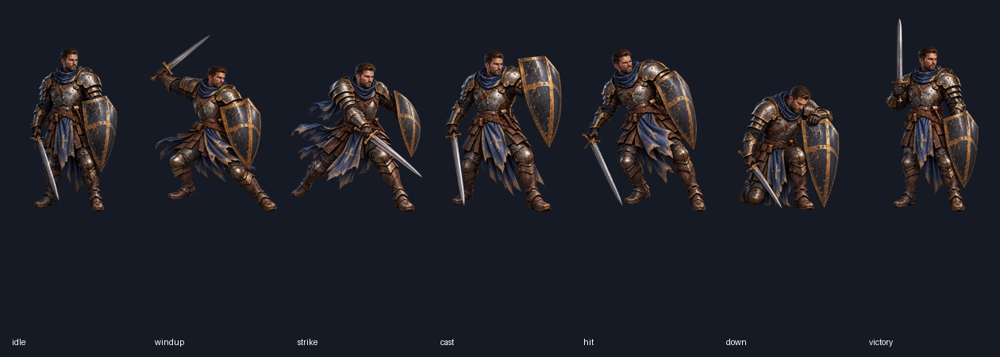
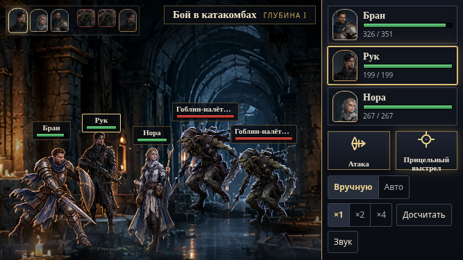
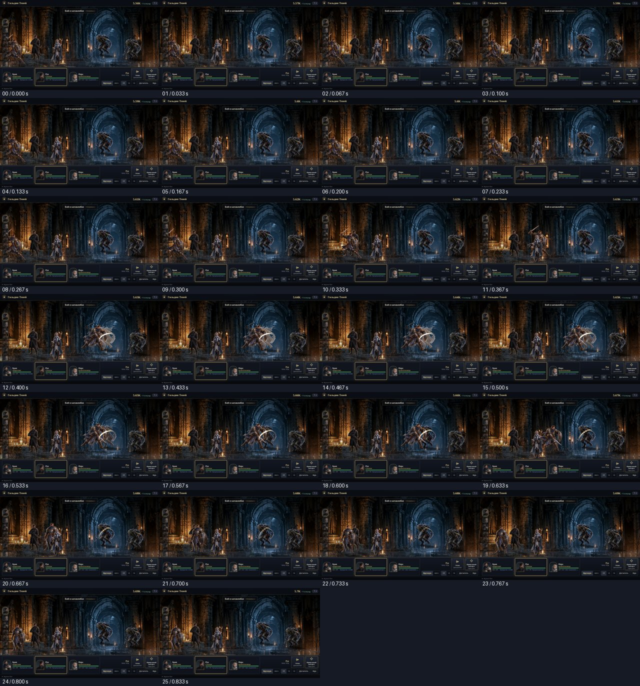

# A-01: результаты авторской проверки

04.11.2026. База `17d707071767b24e963a0014b2721a330bbec544`.
Проверенные входные файлы перечислены с SHA-256 в `tested-inputs.json`.
Проверки относятся к этому пакету, а не к непроверенному объединению с PR #16.

| Проверка | Результат |
|---|---|
| Исходники и канонические референсы | Семь PNG совпадают с PR #11; хеши портрета, спрайта и группового арта совпадают |
| Воспроизводимость | Повторная сборка даёт побайтно одинаковые семь WebP и `poses.json` |
| Геометрия и бюджеты | 522×768, стойка 80,63%, 608,6 КиБ; поля, линия ступней и вынос down проходят |
| Строгий реестр QA | 0 ошибок, 0 предупреждений |
| WebGL (SwiftShader) | Пять разрешений; 35 статичных показов и 970 кадров движения, без обрезаний |
| Canvas 2D | 1920×1080 и 667×375; 14 статичных показов и 388 кадров движения, без обрезаний |
| Production-сценарий | 1920×1080 и 667×375; реальные атака/прикрытие, reload, раунд автобоя, досчёт босса, возврат и экран героя |
| Раскадровка удара | 26 кадров по 1/30 с, ошибок JS нет |
| `npm test` | 127 тестов, 13 файлов, успешно |
| `npm run build` | TypeScript и Vite, успешно |

Полные машинные результаты: `art-audit.json`, `registry-validation.json`,
`webgl.json`, `canvas2d.json`, `production.json`, `strike-strip.json`.

## Граница приёмки

Авторские проверки не заменяют независимую рецензию T2/T5. Реальные устройства,
настоящий SDK Яндекс Игр и производительность GPU этим пакетом не проверялись.
Контролируемые движения рендерера и production-сценарий проверены отдельно.
Полное прохождение босса только автобоем не заявляется: после реального раунда
использована штатная кнопка «Досчитать».

Первый dev-прогон полного сценария дошёл до победы и экрана героя, затем
остановился из-за слишком широкого фильтра файлов в самом проверочном скрипте:
он считал QA-реестр девятым ассетом. Фильтр ограничен каталогом игровых поз;
окончательный production-прогон проверяет точный список восьми файлов.

Оставшиеся художественные замечания, отсутствие PSD/KRA и условия активации
зафиксированы в [передаче](../HANDOFF_RU.md). Пакет не закрывает PR #11 / задачу #7.
