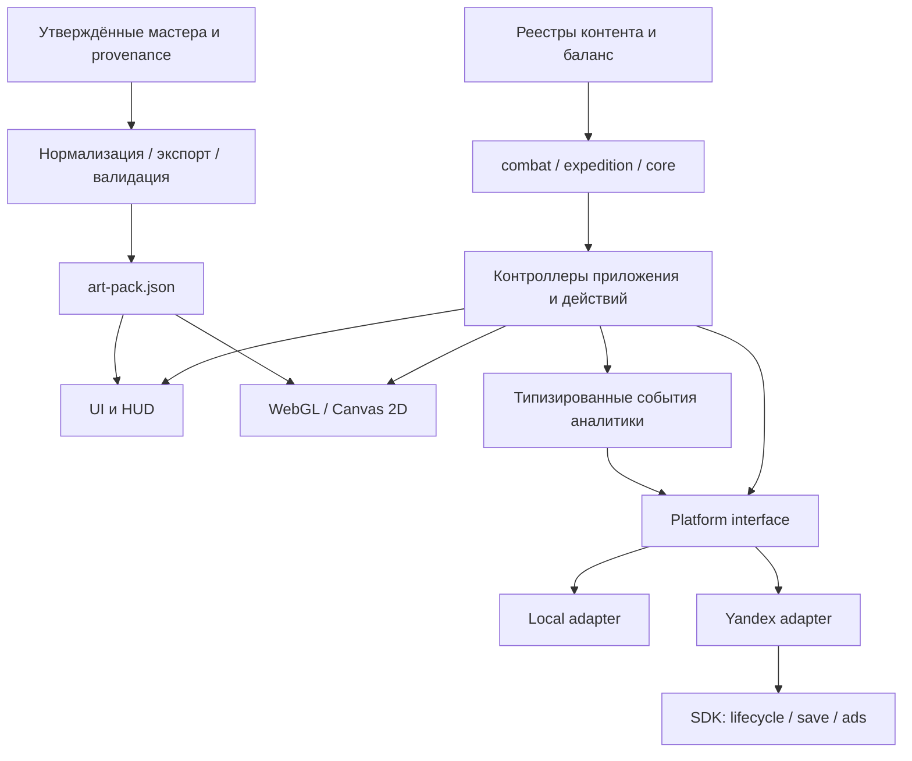

# Архитектура доведения до выпуска — Яндекс Игры

Дата: 04.11.2026. Это план реализации и приёмки, а не заявление о готовности к публикации.

## Исходное состояние

Игра v1.8 уже содержит развитие гильдии, отряд, экспедиции, события, тактический бой, телеграфы и две фазы босса. Есть TypeScript/Vite, тесты Vitest, Playwright, WebGL и Canvas 2D, локальный и Яндекс-адаптеры. Переписывать игру или вводить сервер ради выпуска сейчас не требуется.

Облик 47 поз PR №16 принят [рецензией к 5f28b32](https://github.com/zhopkot-bit/guild-of-shadows/pull/16#pullrequestreview-5710438793). Подготовлены технические производные и игровой реестр. Мира подключена ранее; Бран принят пользователем, но его набор остаётся в отдельной ветке/PR №11. Финальные слои арен ещё не подключены: `arenas` в игровом реестре пуст. Существующие фоны продолжают работать.

Текущий технический проход: [статус и ограничения](art-review/technical-integration-2026-10-30/STATUS_RU.md). Повторная проверка рендерера после исправления масштаба босса остаётся обязательным блокером; старый неуспешный прогон не считается проверкой исправления.

Архив `docs/history/` и ранний `expedition-design.md` содержат прежние решения. Их нельзя использовать для незаметного возвращения отменённых механик. Спорные правила фиксирует владелец продукта в едином релизном объёме.

## Целевая структура

Сохраняем модульное клиентское приложение с одной production-сборкой. Правила игры, отображение и SDK разделены; внешние вызовы выполняются через платформенный интерфейс.

| Граница | Владелец | Обязательный контракт |
|---|---|---|
| Правила и состояние | Команда 1 | UI и SDK не меняют HP, награды или прогресс напрямую; действия проходят через модель |
| Сохранения | Команда 4 совместно с 1 | Версия схемы, миграции, выбор local/cloud, повтор операций без двойной выдачи |
| Бой и отображение | Команда 2 | Фазы действия, impact, опорная точка, восстановление боя и обе фазы короля |
| Ассеты | Команда 3 → 2 | Стабильные id/пути, полный набор состояний, размеры/альфа/бюджеты, происхождение |
| Платформа | Команда 4 | Только `Platform`; пауза, ready, gameplay, реклама и ошибки имеют проверяемые исходы |
| Выпуск | Команда 6 | Один проверенный commit, одинаковые ресурсы в проверке и ZIP; публикация — после решения владельца |

Новый backend, дополнительные площадки, новые классы героев и расширение боевой системы в этот выпуск не входят. Аналитика не является источником игрового состояния. Конкретные актуальные правила SDK и модерации сверяются с официальной документацией перед загрузкой.

## Команды и пакеты работ

Это зоны ответственности; при небольшой команде один человек может совмещать роли. Таблица не означает, что агенты или внешние команды уже запущены.

### Команда 1 — игровой цикл, баланс и контент

**Владелец:** gameplay lead / game designer. Пути: `src/combat/`, `src/expedition/`, `src/core/`, данные контента. Совместные изменения схемы сохранения согласуются с командой 4.

- **G-01:** зафиксировать релизный объём и действующие правила: экономика, ранения/выбывание, рекрутирование, стоимость улучшений, события, награды, реклама. Результат — `RELEASE_SCOPE_RU.md`, перечень механик и спорных решений.
- **G-02:** проверить полный цикл новой игры до босса, победу/поражение, прерывание забега, повторное получение итогов, возврат после перезагрузки. Исправить найденные дефекты с воспроизводимыми сценариями.
- **G-03:** прогнать симуляции баланса и ручные сессии. Представить длительность первого боя/забега, сложность по этапам, темп улучшений и случаи тупика. Целевые значения утверждаются в G-01; симуляции не заменяют пользовательскую проверку.
- **G-04:** сверить EV01–EV06, MOD01–MOD08, описания умений и фактический эффект. Механики, тексты и иконки используют одни id.

**Готово:** нет тупиков и повторной выдачи наград; новая и продолженная игра проходят весь релизный цикл; изменения баланса и сохранений покрыты проверками.

### Команда 2 — интерфейс и игровой рендерер

**Владелец:** frontend/rendering lead. Пути: `src/ui/`, `src/ui/arena/`, CSS. Реестр подключает один назначенный интегратор, а не несколько команд одновременно.

- **U-01 (первым):** повторить проверку текущего исправления масштаба короля, устранить обрезания/скачки ступней, проверить одинаковый размер I/II фаз и соответствие плашек фигурам.
- **U-02:** проверить все 62 предусмотренные позы после подключения Брана: атака, impact, урон, умение, падение, победа, телеграф и переход фазы. Проверить движение, а не только принудительное переключение статичной позы.
- **U-03:** завершить гильдию, отряд, карту, событие, лагерь, награды, итог экспедиции, обучение и состояния ошибки/загрузки. Управление должно читаться на телефоне и работать мышью/касанием.
- **U-04:** проверить экраны 1920×1080, 1366×768, 1024×768, 844×390, 667×375; портретная ориентация показывает заставку поворота. Нет перекрытых кнопок, невидимых целей и обязательной прокрутки боя.
- **U-05:** проверить звуковую паузу, mute, восстановление аудио после рекламы/смены вкладки. При необходимости подключить финальные звуки с командой 3.

**Готово:** одинаковый сценарий проходит в WebGL и запасном Canvas 2D; оба настольных и телефонных варианта читаются; проверены герой, обычные враги и босс.

### Команда 3 — художественный комплект и звук

**Владелец:** art lead; в составе художник персонажей, окружения/UI и ответственный за звук. Пути: `art-sources/`, художественные данные `public/art/`, реестры происхождения.

- **A-01:** передать в интеграцию утверждённого Брана из PR №11; проверить совпадение канона и портретов. Не открывать заново художественную приёмку уже принятых поз без конкретного дефекта.
- **A-02:** решить выявленные ограничения исходников: край сапога Норы, край плаща гоблина, мелкие касания края у короля, размах павшего волка. Исправления рисунка и исключения из ТЗ фиксируются отдельно от изменения холста. Для высокого замаха короля согласовать исключение по доле стойки либо иной допустимый вариант.
- **A-03:** закончить P0-арены: «Катакомбы» и «Тронный склеп», четыре слоя каждой, мастера 2560×1440, прозрачный передний план, координаты света. Проверить перспективу и свободные зоны бойцов по §6 ТЗ.
- **A-04:** провести аудит P1/P2 из `ARTIST_BRIEF_RU.md`: портреты при расхождении с каноном, шесть событий, восемь модулей, шесть узлов, два ресурса, цитадель и пять постов. Готовые ресурсы переиспользовать после приёмки; недостающие сделать. Промо обязательно для выпуска; новые VFX-листы — отдельное улучшение, поскольку процедурные эффекты уже работают.
- **A-05:** собрать комплект звука и музыки, проверить уровни громкости/повторы и список лицензий. Не объявлять право на сторонний материал без подтверждения.

**Готово:** по каждой позиции ТЗ есть принятое изображение/звук либо явно согласованное исключение, источник и лицензия; экспорт проходит бюджеты. Крупные автоматически получаемые PNG не дублируются в Git.

### Команда 4 — Яндекс SDK, сохранения и аналитика

**Владелец:** platform lead. Пути: `src/platform/`, точки lifecycle в приложении, SDK-тесты. Использует уже существующий адаптер; реализация в коде не считается доказательством работы на площадке.

- **P-01:** проверить актуальный SDK в черновике Яндекс Игр: инициализация, `LoadingAPI.ready`, `GameplayAPI.start/stop`, пауза/возврат, сворачивание вкладки и аудио. Проверить зависание/ошибку SDK и допустимость локального fallback для площадки.
- **P-02:** проверить сохранения гостя и доступного облачного игрока: новая/старая схема, конфликт local/cloud, испорченная копия, ошибка сети, очередь/повтор отправки, перезагрузка в бою/событии/награде, отсутствие потери прогресса. Аудит повторной отправки особенно нужен после `cloud_save_failed`.
- **P-03:** проверить rewarded и interstitial: успех, закрытие без награды, ошибка, timeout, повтор callback, повторное нажатие, перезагрузка. Награда выдаётся однократно и только при подтверждённом условии просмотра; отказ рекламы не блокирует основной цикл.
- **P-04:** завершить ограниченную типизированную аналитику: загрузка, обучение, начало/итоги забега, прогресс, ошибки сохранений, реклама. В адаптере уже есть отправка целей при настроенной Метрике; отдельно проверить конфигурацию, доставку и отсутствие лишних данных.
- **P-05:** проверить язык, данные карточки, требования модерации и допустимые размещения рекламы по актуальным правилам площадки; результаты приложить к RC.

**Готово:** SDK-сценарии подтверждены в черновике платформы, а не только заглушкой; нет двойных наград и потери прогресса; SDK-ошибки не оставляют приложение навечно на паузе.

### Команда 5 — независимая приёмка и производительность

**Владелец:** QA lead. Пути: `tests/`, `tools/qa/`, отчёты и внешний архив доказательств.

- **Q-01:** вести матрицу «требование → сценарий → результат → артефакт». Старые успешные отчёты не заменяют проверку нового commit. Текущий тестовый и сборочный baseline — в отчёте технического этапа.
- **Q-02:** проверить полный цикл, сохранения, рекламу, обе фазы босса, обучение, ориентацию и возврат в игру; повторить на production-сборке.
- **Q-03:** проверять Chrome/Firefox на настольном устройстве, Android Chrome и iOS Safari на реальных телефонах. Эмуляция размера окна не подтверждает производительность телефона или работу SDK.
- **Q-04:** замерить холодный старт, загрузку ресурсов, FPS/время кадра, память, длинную игровую сессию и восстановление WebGL. Исправления выполняют владельцы соответствующих модулей.
- **Q-05:** проверить ZIP и ассеты на отсутствующие файлы, размеры/альфу/бюджеты; сформировать список блокеров и повторные проверки исправлений.

**Предлагаемые проектные бюджеты для утверждения в G-01:** доступность первого управления ≤5 с на выбранном среднем Android и согласованном сетевом профиле; устойчивые ≥30 FPS на минимальном устройстве; отсутствие падения/потери прогресса за 30 минут; 0 блокирующих/критических дефектов. Это внутренние цели, не заявленные требования Яндекса. Устройства, профиль сети, допустимые задержки кадров и память фиксируются до замеров.

### Команда 6 — интеграция и выпуск

**Владелец:** release lead / технический лидер. Пути: CI, сборочные инструменты, release manifests; один владелец общих реестров и финальной ветки.

- **R-01:** собрать принятые PR в интеграционной ветке. PR №16 остаётся черновиком до закрытия блокеров. Сохранить traceability художественных решений и не потерять интеграцию Миры/Брана при конфликтах.
- **R-02:** настроить CI: установка по lockfile, typecheck/tests/build, строгая проверка арта, проверка отсутствующих ассетов и браузерный smoke на production. Технические мастера воспроизводятся из источников и настроек; в игровой архив входят только необходимые ресурсы.
- **R-03:** зафиксировать RC по commit/hash. Собрать ZIP из `dist` с `index.html` в корне, проверить пути после загрузки в черновик; подготовить обложку, иконку, скриншоты, описание, управление и настройки горизонтальной ориентации по актуальным требованиям консоли.
- **R-04:** провести совместный go/no-go по доказательствам команд 1–5. Подготовить предыдущий рабочий ZIP, инструкцию отката и совместимость сохранений при откате.
- **R-05:** после разрешения владельца подать RC на модерацию и опубликовать. После выпуска контролировать ошибки старта, сохранений и рекламы; исправления выпускать отдельными проверенными версиями.

**Готово:** опубликована именно проверенная сборка; известны владелец реакции на инциденты, способ отката и порядок hotfix. Создание плана не разрешает автоматическую публикацию.

## Очерёдность и зависимости

| Волна | Параллельная работа | Условие выхода |
|---|---|---|
| 0 — закрытие исходного состояния | U-01; G-01; R-01/R-02; Q-01; решения A-02 | Согласован объём, список блокеров и владельцы; повторно проверено размещение короля |
| 1 — законченный вертикальный срез | A-01/A-03 + U-02/U-03; P-01/P-02; G-02/G-04 | Новая игра → экспедиция → босс I/II → итог → reload проходит на production |
| 2 — качество контента и платформы | A-04/A-05; U-04/U-05; P-03/P-04/P-05; G-03; Q-03/Q-04 | Принят весь релизный контент, реальные устройства и SDK-сценарии проходят |
| 3 — стабилизация RC | Q-02/Q-05; исправления владельцами; R-03/R-04 | Нет блокирующих/критических дефектов, полный регресс и пакет доказательств одного RC |
| 4 — выпуск | R-05, QA smoke в черновике, владелец продукта | Go владельца, модерация площадки, проверка опубликованной версии |

Критический путь: решения по объёму/арт-ограничениям → законченный срез → реальные SDK/устройства → стабилизация → RC → модерация. SDK и арены нужно делать параллельно; финальные скриншоты магазина снимаются после стабилизации визуального слоя.

До оценки длительности каждая команда оценивает свои пакеты в человеко-днях и отмечает доступность исполнителей. Срок модерации не подменяется оценкой разработки. Даты выпуска из одного числа поз выводить нельзя.

## Правила совместной работы

- Каждому G/U/A/P/Q/R-пакету — задача с владельцем, зависимостями, проверками и ссылкой на PR. Статусы: ready → in progress → review → verified → done; blocked содержит конкретную причину.
- Отдельная ветка и небольшой PR на пакет. Общие `art-pack.json`, реестры контента и схема сейва изменяются через назначенных владельцев контрактов.
- Изменение сохранения требует миграции и проверки старых данных; изменение артикуляции действия — проверки impact и рендера; замена ассетов — происхождения и повторной проверки бюджета.
- В RC не добавляются новые функции. Исключения по ТЗ, необязательная полировка и принятые некритичные дефекты перечисляются явно.
- Приоритеты дефектов: блокер — не стартует/теряется прогресс/дублируется награда; критический — ломается основной цикл/реклама оставляет паузу/важное управление недоступно; прочие дефекты ранжируются по влиянию. Go/no-go опирается на результаты, а не на количество закрытых задач.

## Первый пакет запуска

1. Командам 2 и 5 — повторить U-01 и движения U-02 на окружении, где доступны сервер и Chromium; приложить новый отчёт после исправления, включая Canvas 2D.
2. Владельцу продукта и командам 1/3 — закрыть G-01 и решения A-02, назначить интеграцию Брана и объём арен.
3. Команде 4 — начать P-01/P-02 в черновике Яндекс Игр; локальные успешные тесты не заменяют эту работу.
4. Команде 6 — подготовить CI и интеграционную ветку; затем команды работают по волнам выше.
