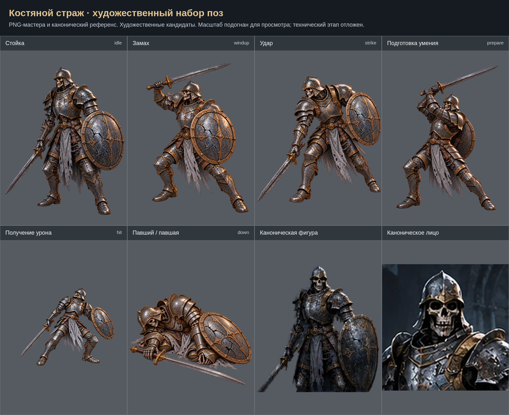

# Костяной страж: художественный набор

Созданы 6 кандидатов поз. Обзорный лист не заменяет финальный лист выравнивания. Исходные PNG сохранены без программной ретуши. Техническая интеграция и проверки отложены на общий завершающий этап. Приёмка пользователем пока не зафиксирована.

- [Стойка (idle)](../../../art-sources/poses/boneGuard/proposals/idle.png)
- [Замах (windup)](../../../art-sources/poses/boneGuard/proposals/windup.png)
- [Удар (strike)](../../../art-sources/poses/boneGuard/proposals/strike.png)
- [Подготовка умения (prepare)](../../../art-sources/poses/boneGuard/proposals/prepare.png)
- [Получение урона (hit)](../../../art-sources/poses/boneGuard/proposals/hit.png)
- [Павший / павшая (down)](../../../art-sources/poses/boneGuard/proposals/down.png)

## Художественный просмотр 29.10.2026

[Результаты и открытые пункты](../ART_REVIEW_2026_10_29_RU.md). [Сравнения правок](../art-review-2026-10-29/index.html).
