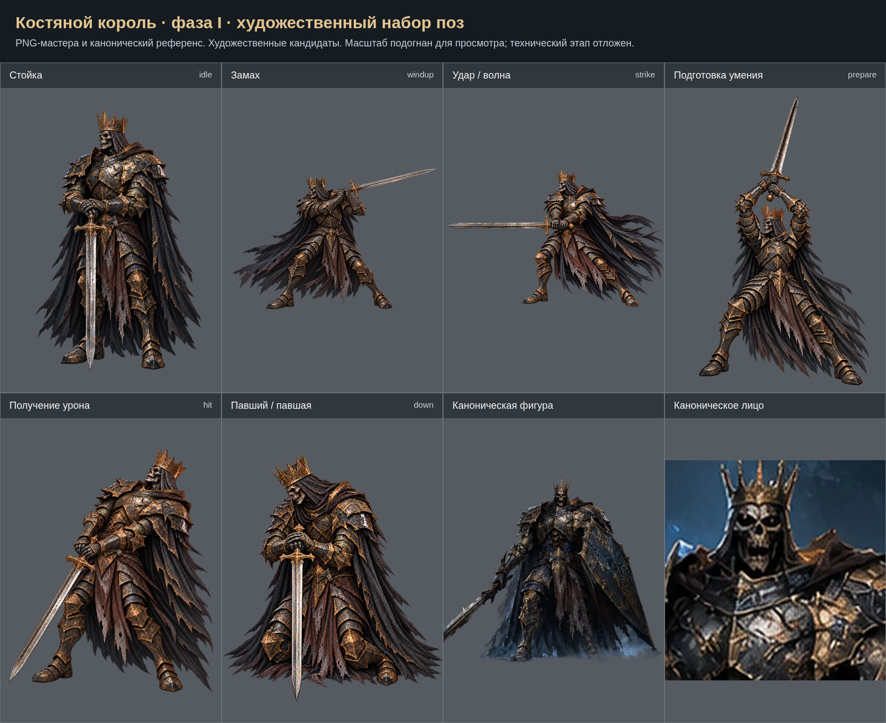

# Костяной король · фаза I: художественный набор

Созданы 6 кандидатов поз. Обзорный лист не заменяет финальный лист выравнивания. Исходные PNG сохранены без программной ретуши. Техническая интеграция и проверки отложены на общий завершающий этап. Приёмка пользователем пока не зафиксирована.

- [Стойка (idle)](../../../art-sources/poses/boneKing/proposals/idle.png)
- [Замах (windup)](../../../art-sources/poses/boneKing/proposals/windup.png)
- [Удар / волна (strike)](../../../art-sources/poses/boneKing/proposals/strike.png)
- [Подготовка умения (prepare)](../../../art-sources/poses/boneKing/proposals/prepare.png)
- [Получение урона (hit)](../../../art-sources/poses/boneKing/proposals/hit.png)
- [Павший / павшая (down)](../../../art-sources/poses/boneKing/proposals/down.png)

## Художественный просмотр 29.10.2026

[Результаты и открытые пункты](../ART_REVIEW_2026_10_29_RU.md). [Сравнения правок](../art-review-2026-10-29/index.html).

## Рецензия PR №16 — 30.10.2026

[Обработанные замечания и оставшийся пункт](../REVIEW_PR16_2026_10_30_RU.md). Лист выше обновлён по текущим кандидатам.

По замечаниям пользователя от 30.10 подготовка умения перегенерирована: уточнены обе руки, рукоять и гамма в соответствии со стойкой. [Описание правок](../USER_REVIEW_2026_10_30_RU.md).

После разрешения пользователя кисти и меч слегка подняты, а голова согласована со стойкой. [Описание правки](../REVIEW_PR16_FOLLOWUP_2026_10_30_RU.md) · [Сравнение по голени](head-comparison.png) · [Послойный PSD](../../../art-sources/poses/boneKing/layers/prepare-head-lift-2026-10-30.psd).
