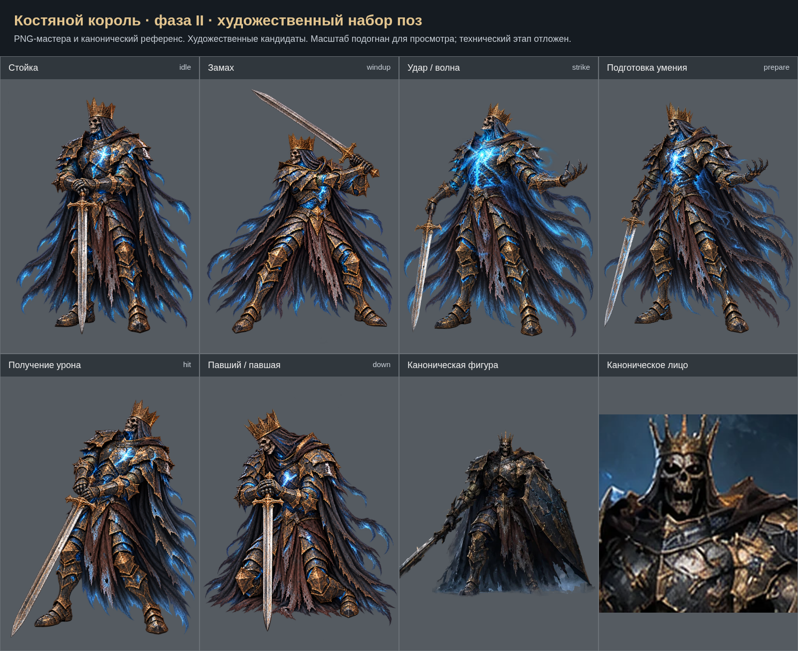

# Костяной король · фаза II: художественный набор

Созданы 6 кандидатов поз. Обзорный лист не заменяет финальный лист выравнивания. Исходные PNG сохранены без программной ретуши. Техническая интеграция и проверки отложены на общий завершающий этап. Приёмка пользователем пока не зафиксирована.

- [Стойка (idle)](../../../art-sources/poses/boneKingPhase2/proposals/idle.png)
- [Замах (windup)](../../../art-sources/poses/boneKingPhase2/proposals/windup.png)
- [Удар / волна (strike)](../../../art-sources/poses/boneKingPhase2/proposals/strike.png)
- [Подготовка умения (prepare)](../../../art-sources/poses/boneKingPhase2/proposals/prepare.png)
- [Получение урона (hit)](../../../art-sources/poses/boneKingPhase2/proposals/hit.png)
- [Павший / павшая (down)](../../../art-sources/poses/boneKingPhase2/proposals/down.png)
