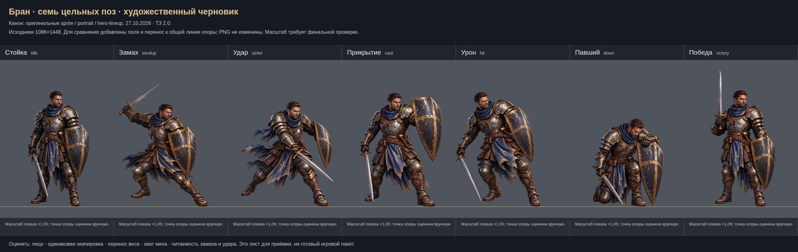
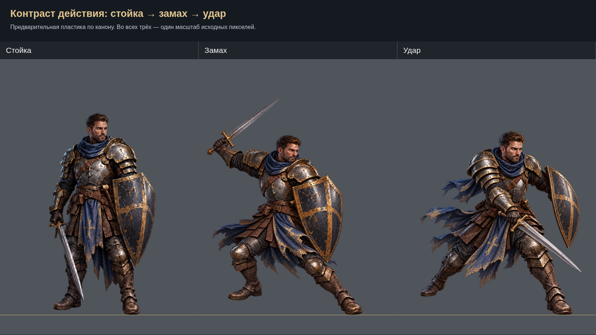
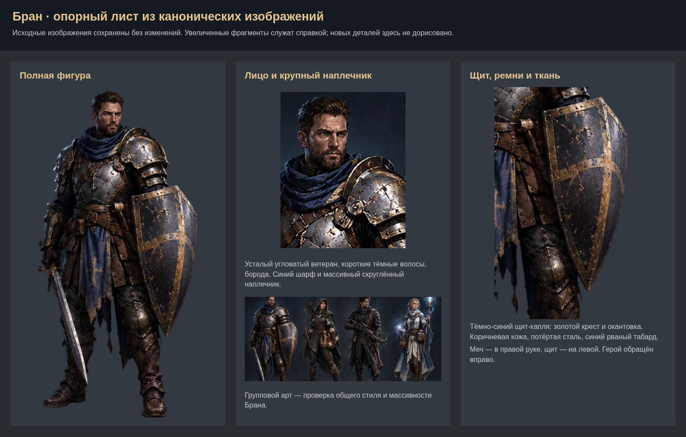

# Бран: семь цельных поз по ТЗ 2.0

**Художественный черновик от 27.10.2026.** Предлагаемый облик и пластика ещё не приняты. Подключение к основному арт-пакету не выполнено.

[Открыть лист семи поз в полном размере](consistency-sheet.png) · [Замах и удар крупнее](action-comparison.png) · [Канонический опорный лист](reference-sheet.png) · [Отчёт и незакрытые требования](REPORT_RU.md)

| Поза | Полный PNG |
|---|---|
| Стойка | [idle](../../../art-sources/poses/bran/proposals/idle.png) |
| Замах, переработанный | [windup](../../../art-sources/poses/bran/proposals/windup.png) |
| Удар | [strike](../../../art-sources/poses/bran/proposals/strike.png) |
| Прикрытие | [cast](../../../art-sources/poses/bran/proposals/cast.png) |
| Получение урона | [hit](../../../art-sources/poses/bran/proposals/hit.png) |
| Павший — на колене с опорой на щит | [down](../../../art-sources/poses/bran/proposals/down.png) |
| Победа, переработанная | [victory](../../../art-sources/poses/bran/proposals/victory.png) |

## Движение всем телом

## Канон для сравнения

Для просмотра позы выровнены переносом к общей линии; коэффициенты показа указаны на листе. Оригинальные PNG не изменены. Лист показывает художественное направление, а не готовую анимацию в игре.
