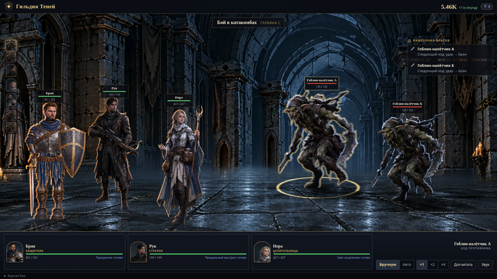
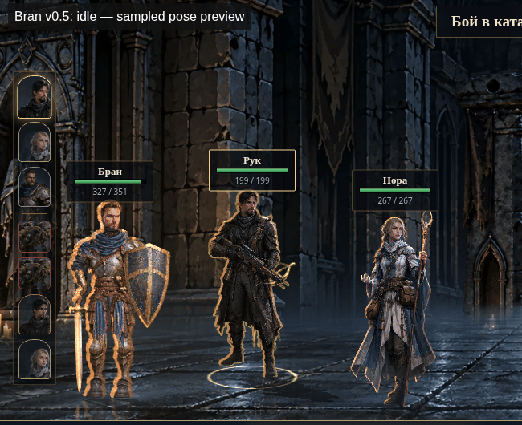

# Бран v0.5 — повторная художественная приёмка

Риг по согласованному концепту подключён к игре, крипта собрана из четырёх самостоятельных слоёв. **Это черновая поставка: оригинальные мастера и `.dbproj` отсутствуют, художественная приёмка ещё не пройдена.**

[Черновой PR #5](https://github.com/zhopkot-bit/guild-of-shadows/pull/5) · [Подробный отчёт о тестах и недостатках](REPORT_RU.md) · [Согласованный концепт](concept.png) · [Исходники Брана](../../../art-sources/bran-v05) · [Исходники крипты](../../../art-sources/crypt-v05)

Обновлено 27.10.2026: новый нагрудник и пояс без повторных ремней, отдельные тканевые детали, вторичное движение в attack/death/victory. [Сборка слоёв крупным планом](bind-pose.png) — техническая поза, не оригинальный мастер.

## В настоящей игре

| Размер | WebGL | Canvas 2D |
|---|---|---|
| 1920×1080 | [Открыть](webgl-bran-game-1920x1080.png) | [Открыть](canvas-bran-game-1920x1080.png) |
| 1366×768 | [Открыть](webgl-bran-game-1366x768.png) | [Открыть](canvas-bran-game-1366x768.png) |
| 1024×768 | [Открыть](webgl-bran-game-1024x768.png) | [Открыть](canvas-bran-game-1024x768.png) |
| 390×844 | [Открыть](webgl-bran-game-390x844.png) | [Открыть](canvas-bran-game-390x844.png) |

## Шесть клипов

[Открыть GIF отдельно](preview.gif). 81 выбранная поза действующего игрового рендерера, около 12 кадров/с. Это не запись естественной очередности боя и не замер FPS.

[Падение — последний кадр](death-end.png) · [Hit](hit-mid.png) · [Attack](attack-mid.png) · [Смерть в сцене](death.png) · [После воскрешения](revive.png)

[Итоги сквозного прохождения](expedition-complete.png) · [Машинные результаты и хеши файлов](evidence)

После смены среды нарезка и слои восстановлены заново; все приведённые результаты получены повторно. Согласование концепта не означает автоматическую приёмку этой сборки или разрешение на слияние с main.
