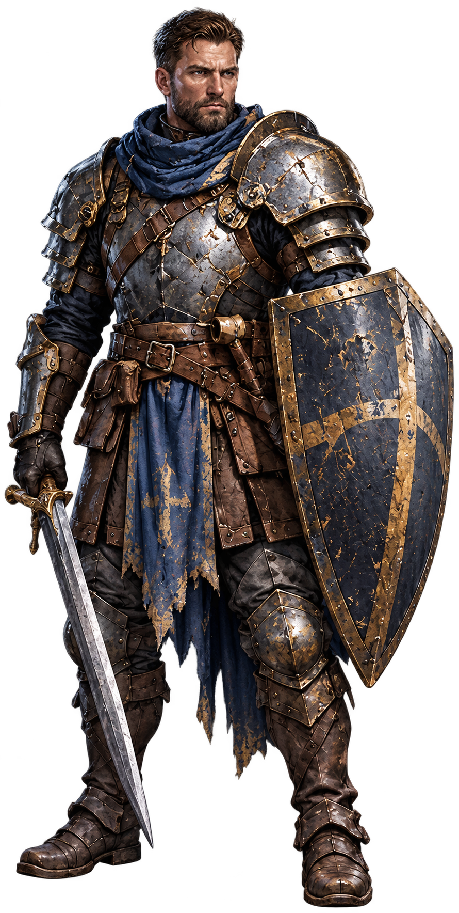

# Бран v0.5 — согласование внешности

[Открыть изображение отдельно](concept.png)

На этом этапе согласуются лицо, короткая причёска, тяжёлые доспехи, щит и пропорции. Это генеративная заготовка по утверждённым sprite.webp и portrait.webp Брана из main. Она ещё не является согласованным арт-ресурсом, многослойным мастером или готовым ригом; к игре не подключена.

После согласования внешности предстоят нарезка с дорисовкой скрытых областей, создание скелета и анимаций, подготовка исходников и игровая проверка. Согласование рисунка не означает разрешение на слияние изменений с main.
