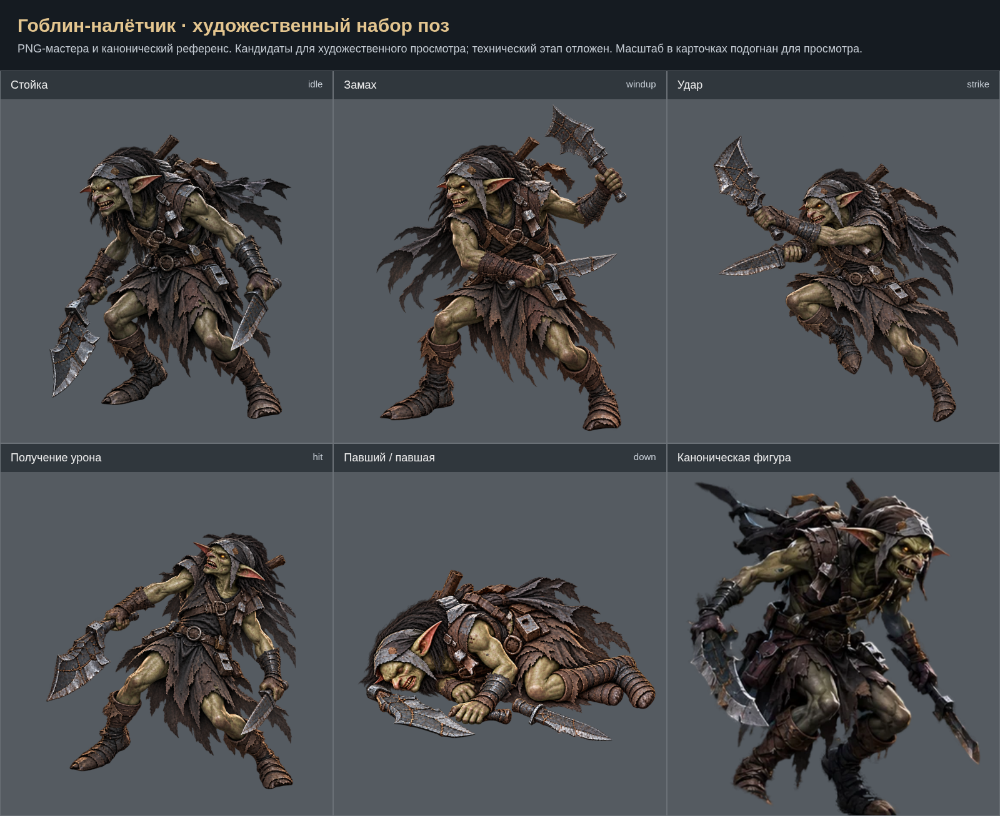

# Гоблин-налётчик: художественный набор

Созданы 5 кандидатов поз по ТЗ; это обзор рисунков, не финальный лист выравнивания. Исходные PNG сохранены без программной ретуши. Техническая интеграция и проверки отложены на общий завершающий этап. Приёмка пользователем пока не зафиксирована.

- [Стойка (idle)](../../../art-sources/poses/goblinRaider/proposals/idle.png)
- [Замах (windup)](../../../art-sources/poses/goblinRaider/proposals/windup.png)
- [Удар (strike)](../../../art-sources/poses/goblinRaider/proposals/strike.png)
- [Получение урона (hit)](../../../art-sources/poses/goblinRaider/proposals/hit.png)
- [Павший / павшая (down)](../../../art-sources/poses/goblinRaider/proposals/down.png)

## Художественный просмотр 29.10.2026

[Результаты и открытые пункты](../ART_REVIEW_2026_10_29_RU.md). [Сравнения правок](../art-review-2026-10-29/index.html).

## Рецензия PR №16 — 30.10.2026

[Обработанные замечания и оставшийся пункт](../REVIEW_PR16_2026_10_30_RU.md). Лист выше обновлён по текущим кандидатам.

По замечанию пользователя от 30.10 замах перегенерирован из-за строения корпуса и рук; [описание правки](../USER_REVIEW_2026_10_30_RU.md).
