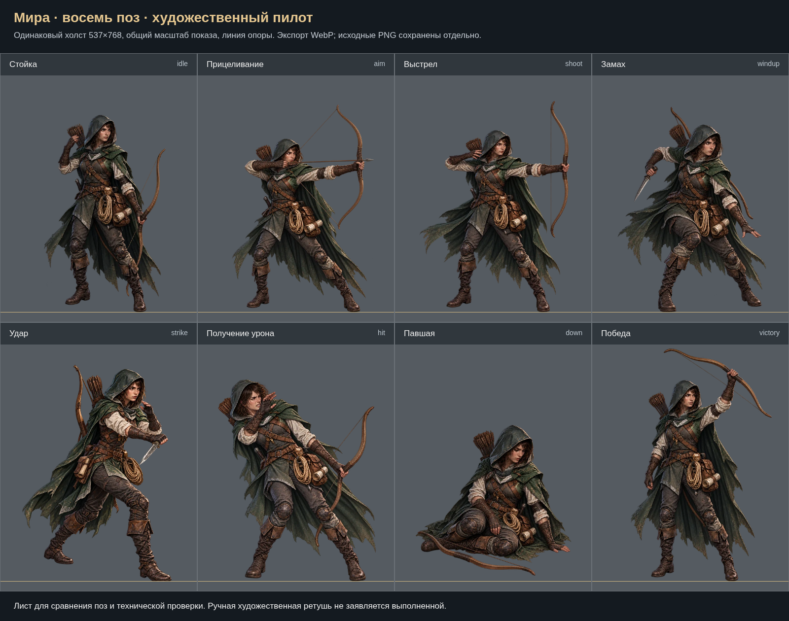

# Мира — восемь поз

28.10.2026. Художественный пилот по ТЗ 2.1. Канонические лицо, капюшон, плащ, кожаный доспех, лук, колчан, верёвка и свиток служат основой всего набора.

Атака `strike` v9 принята пользователем 28.10.2026 («Последний зачёт»).

| Поза | PNG-мастер |
|---|---|
| Стойка | [idle](../../../art-sources/poses/mira/proposals/idle.png) |
| Прицеливание | [aim](../../../art-sources/poses/mira/proposals/aim.png) |
| Выстрел | [shoot](../../../art-sources/poses/mira/proposals/shoot.png) |
| Замах ножом | [windup](../../../art-sources/poses/mira/proposals/windup.png) |
| Удар ножом | [strike](../../../art-sources/poses/mira/proposals/strike.png) |
| Получение урона | [hit](../../../art-sources/poses/mira/proposals/hit.png) |
| Павшая | [down](../../../art-sources/poses/mira/proposals/down.png) |
| Победа | [victory](../../../art-sources/poses/mira/proposals/victory.png) |

[Канонический опорный лист](reference-sheet.png) · [Исходники, инструменты и сборка](../../../art-sources/poses/mira/README_RU.md) · [Отчёт](REPORT_RU.md).

[Атака: принятая правка оси ножа, сравнение v7/v9](attack-comparison.png).

Лист показывает реальный технический экспорт на одинаковых холстах с общей линией опоры. Статус ручной художественной доводки и оставшиеся замечания описаны в отчёте.

Восемь поз подключены к обычной игре. [Интеграция и проверки](INTEGRATION_RU.md).
