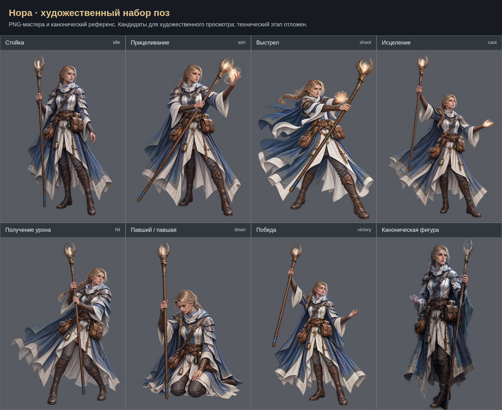

# Нора: художественный набор

Созданы 7 поз по ТЗ. Исходные PNG сохранены без программной ретуши. Техническая интеграция и проверки отложены на общий завершающий этап. Приёмка пользователем пока не зафиксирована.

- [Стойка (idle)](../../../art-sources/poses/nora/proposals/idle.png)
- [Прицеливание (aim)](../../../art-sources/poses/nora/proposals/aim.png)
- [Выстрел (shoot)](../../../art-sources/poses/nora/proposals/shoot.png)
- [Исцеление (cast)](../../../art-sources/poses/nora/proposals/cast.png)
- [Получение урона (hit)](../../../art-sources/poses/nora/proposals/hit.png)
- [Павший / павшая (down)](../../../art-sources/poses/nora/proposals/down.png)
- [Победа (victory)](../../../art-sources/poses/nora/proposals/victory.png)

## Художественный просмотр 29.10.2026

[Результаты и открытые пункты](../ART_REVIEW_2026_10_29_RU.md). [Сравнения правок](../art-review-2026-10-29/index.html).
