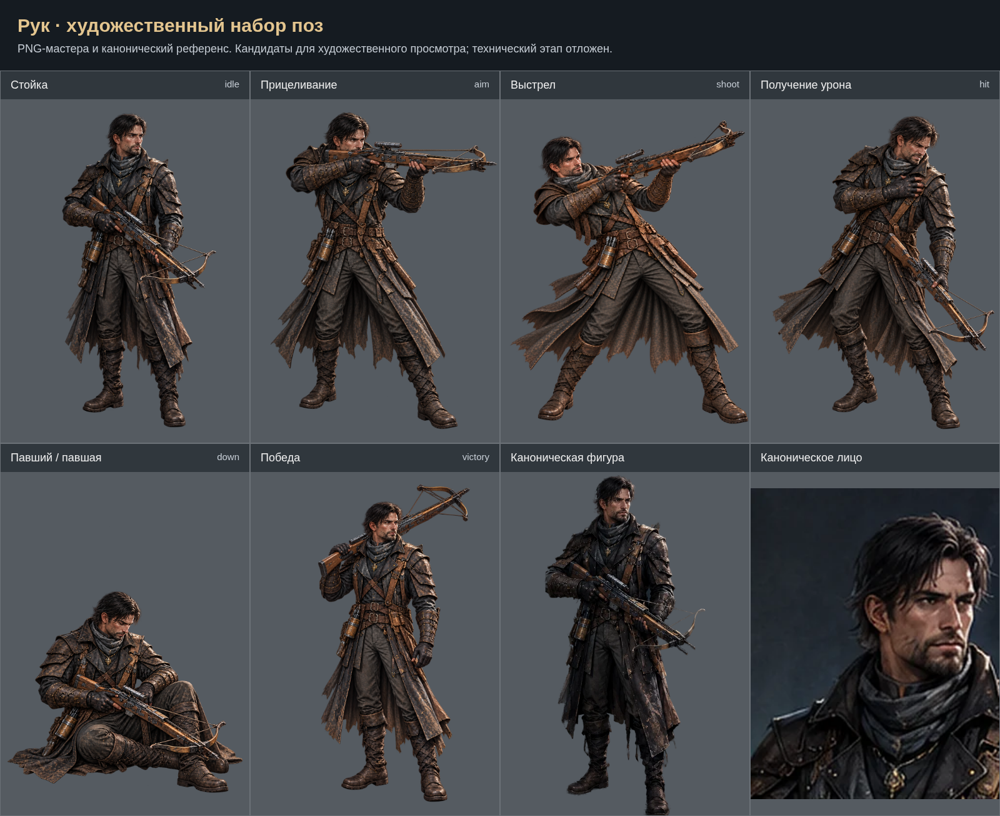

# Рук: художественный набор

Созданы 6 поз по ТЗ. `shoot` включает локальную послойную правку в GIMP с использованием генеративного фрагмента; [PSD](../../../art-sources/poses/rook/layers/shoot-review-2026-10-30.psd). Техническая интеграция и проверки отложены на общий завершающий этап. Приёмка пользователя для правки пока не зафиксирована.

- [Стойка (idle)](../../../art-sources/poses/rook/proposals/idle.png)
- [Прицеливание (aim)](../../../art-sources/poses/rook/proposals/aim.png)
- [Выстрел (shoot)](../../../art-sources/poses/rook/proposals/shoot.png)
- [Получение урона (hit)](../../../art-sources/poses/rook/proposals/hit.png)
- [Павший / павшая (down)](../../../art-sources/poses/rook/proposals/down.png)
- [Победа (victory)](../../../art-sources/poses/rook/proposals/victory.png)

## Художественный просмотр 29.10.2026

[Результаты и открытые пункты](../ART_REVIEW_2026_10_29_RU.md). [Сравнения правок](../art-review-2026-10-29/index.html).

## Рецензия PR №16 — 30.10.2026

[Обработанные замечания и оставшийся пункт](../REVIEW_PR16_2026_10_30_RU.md). Лист выше обновлён по текущим кандидатам.

[Повторная рецензия и локальная правка](../REVIEW_PR16_FOLLOWUP_2026_10_30_RU.md) · [Сравнение поз в общем масштабе](scale-comparison.png).
